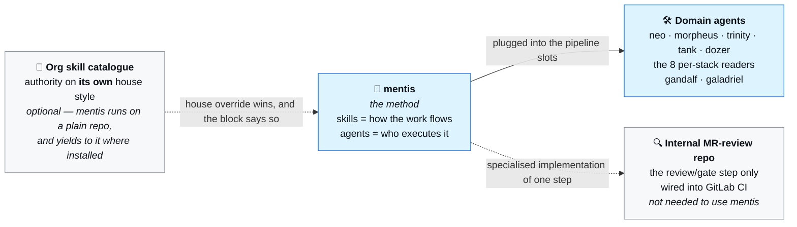
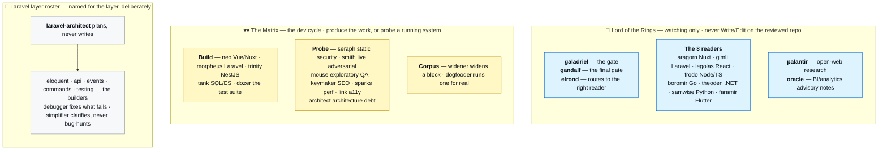
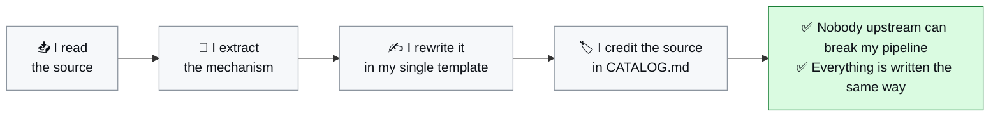
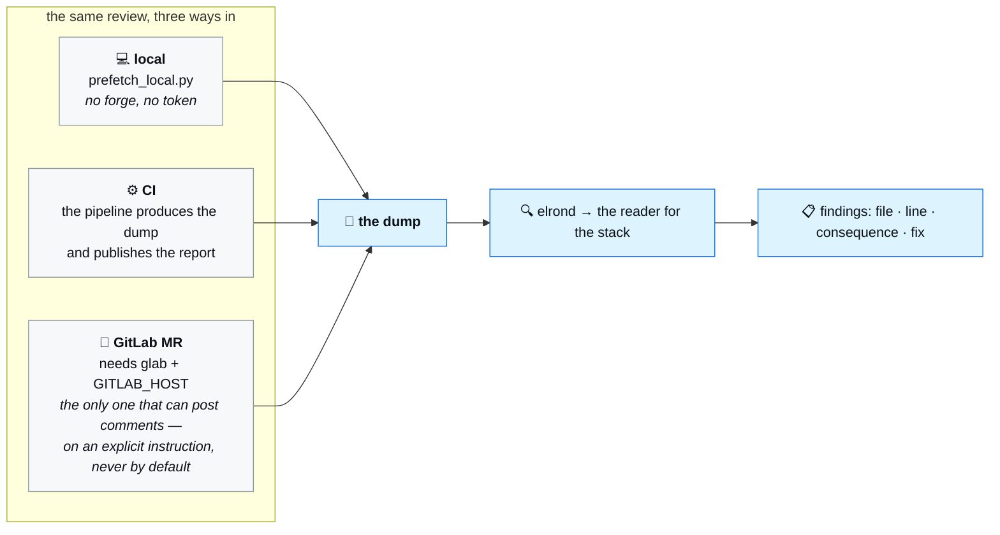
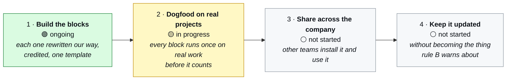

<h1 align="center">mentis</h1>

<p align="center">
  <em>An agent-and-skill framework for Claude Code covering the whole dev cycle — not just review.</em><br>
  <em>Every useful idea on the market, rewritten in my own voice, in one template, depending on no upstream repo.</em>
</p>

<p align="center">
  
  
  
  
  
  
  <a href="./LICENSING.md"></a>
</p>

> [!NOTE]
> **"The operator"**, throughout the blocks and agents, means whoever installs mentis — you.
> Where an agent states a confidence level per stack (**learner** register on PHP, Go, .NET, Python,
> Flutter; **assertive** on Vue/Nuxt, React, Node/TS), that is my own calibration and the one thing
> you should retune before using those readers.

Test repo for my way of working with Claude Code. A separate, internal MR-review implementation
covers the review/gate step alone, wired into GitLab CI; **this repo covers everything else**:
brainstorm → spec → plan → TDD → code → debug → gate → ship.

---

## At a glance

| | Count | Maturity |
|---|---:|---|
| 🧩 **Skills** — the method, one file per rule | **375** | 🟢 9 with real production use · 🟡 the rest written, not run |
| 🤖 **Agents** — who executes it | **35** | 🟢 21 dogfooded or production-run · 🟡 the rest written |
| 💼 **Business blocks** — the company's other functions | **46** | 🟡 by contract, they never gate ([why](./business/README.md)) |
| 🪝 **Hooks** — the gate pair, the test guard, the install guard, nine opt-in guards | **13** | 🟢 the first 4 wired into one real repo, 2026-09-09; 🟡 the 9 opt-in |
| 🧪 **`bin/`** — review transports + repo self-checks | **13 suites** | 🟢 run on every push (`bin/pre-push`) |

**Maturity legend** — 🟢 has run on real work · 🟡 written, reviewed, never run.
The line-by-line breakdown is [`CATALOG.md`](./CATALOG.md); the summary is [Status](#status).

<table>
<tr>
<td width="50%" valign="top">

**Start here**

- 📖 [How I write and govern my agents](./doc/HOW-WE-WRITE-OUR-AGENTS.md) — the doc to read to understand everything, with diagrams
- 🧭 [`WORKFLOW.md`](./WORKFLOW.md) — the numbered pipeline, step → block routing
- 📚 [`CATALOG.md`](./CATALOG.md) — the registry, every idea credited to its real source
- 📐 [`CONVENTIONS.md`](./CONVENTIONS.md) — the single template, rules A to E
- 🤝 [`CONTRIBUTING.md`](./CONTRIBUTING.md) — PR-only, and the contribution terms
- ⚖️ [`LICENSING.md`](./LICENSING.md) — AGPL-3.0-or-later, or a commercial licence
- 🖥️ [The native platform surface](./references/claude-code-platform.md) — what Claude Code already provides, so no block reimplements it

</td>
<td width="50%" valign="top">

**On this page**

- [Why my own version](#why-my-own-version)
- [Positioning](#positioning)
- [The pipeline](#the-pipeline)
- [What's inside](#whats-inside)
- [The rule that keeps me in control](#the-rule-that-keeps-me-in-control)
- [Public repo, protected branch](#public-repo-protected-branch) · [Versioning](#versioning)
- [Quickstart](#quickstart)
- [Running a review](#running-a-review)
- [Maintaining this repo](#maintaining-this-repo)
- [Where this is going](#where-this-is-going) · [Status](#status)

</td>
</tr>
</table>

### Two things worth knowing before the tour

> [!IMPORTANT]
> **20 of the 35 agents deny their forbidden tools in the frontmatter**, not only in their prose.
> Twelve of them had carried *"Never Write/Edit: you fix nothing, you report"* while the runtime
> handed them every tool — a guarantee that held only as long as the model chose to honour it, which
> is precisely the thing this repo refuses to accept from anyone else. The implementers write code
> and are untouched. The one prohibition still resting on trust is the readers'
> *"write only inside the scratch directory"*, because `disallowedTools` cannot be scoped to a path,
> and each reader's contract now says so explicitly instead of implying the runtime has it covered.

**What a session actually loads.** Every block description sits in the system prompt of every session
whether or not it gets used, so they are sized for routing, not for summarising: **~23 KB** for the whole
corpus. A block is loaded whole when invoked, so the five big convention blocks are a `Steps` table
naming, per section, the condition under which that section has to be read — a task touching two of
them loads **9 KB rather than 26 KB**. What the agents write back is capped too
([`terse-reporting.md`](./references/terse-reporting.md)): verdict first, one line per finding, no
preamble — with negation, verdict word, confidence level and quoted evidence explicitly exempt from
the compression.

---

## Why my own version

An equivalent framework on the open source market already encodes solid generic discipline:
brainstorming, TDD, systematic debugging, fresh-context review. But a generic method does not carry
my house conventions, my real stacks (Nuxt/Vuetify, Laravel, React), nor my own core requirement —
**default = failure**: work declared "done" is never taken on trust, it has to be proven. That is the
role of [`galadriel`](./agents/galadriel.md), the agent that embodies this rule and that none of the
market sources I looked at covers.

Rather than installing such a framework as-is, I rewrote every useful idea in my own template, with
my voice, my examples, my stack. **I never depend on an external repo to keep my pipeline running.**

## Positioning



The reference audit answered a 211-skill, ten-plugin catalogue. Those rules were mined, de-identified
and rewritten generically into the per-stack blocks, so **every block works on a plain repo**. What
landed where: [`CATALOG.md`](./CATALOG.md) §0.

## The pipeline

```mermaid
flowchart LR
    subgraph FRAME["🧭 Frame"]
      direction LR
      S["0 · start-feature"] --> A["1 · brainstorm"] --> B["2 · spec"] --> C["3 · archi"] --> D["4 · plan"]
    end
    subgraph BUILD["🔨 Build"]
      direction LR
      E["5 · tdd<br/><i>dozer</i>"] --> F["6 · code<br/><i>neo · morpheus · trinity · tank</i>"] --> G["debug"]
    end
    subgraph PROVE["🛡️ Prove — fresh context only"]
      direction LR
      H["7 · gate<br/><i>galadriel</i>"] --> I["8 · review<br/><i>elrond → the readers</i>"] --> J["9 · simplify"]
    end
    subgraph SHIP["🚀 Ship"]
      direction LR
      K["10 · ship<br/><i>gandalf</i>"] --> L["11 · finish"]
    end

    D --> E
    G --> H
    J --> K
    BUG(["🐞 a reported bug"]) --> T["bug-triage"] --> G

    H -. "NEEDS_WORK — measurable exit, driven by /goal" .-> F
    I -. "findings — manual, turn-based" .-> F

    classDef frame fill:#f6f8fa,stroke:#8c959f,color:#0d1117
    classDef build fill:#fff8c5,stroke:#bf8700,color:#0d1117
    classDef prove fill:#ddf4ff,stroke:#0969da,color:#0d1117
    classDef ship fill:#dafbe1,stroke:#1a7f37,color:#0d1117
    classDef bug fill:#ffebe9,stroke:#cf222e,color:#0d1117
    class S,A,B,C,D frame
    class E,F,G build
    class H,I,J prove
    class K,L ship
    class BUG,T bug
```



**Exactly two loops close backwards**, and only these two: the gate returning `NEEDS_WORK`, and the
review producing findings. Both land back in `code`; everything else moves forward. A reported bug
enters through `bug-triage`, which turns a report into a reproducible case before `debug` starts.

| Guarantee | What it forbids |
|---|---|
| 🧊 **Fresh context** | Whoever judges never watched the code being written — `galadriel`, the readers, `gandalf` |
| ❌ **Default = failure** | Nothing is believed without a cited piece of evidence. "It works" is a claim until it is an artefact |

Step-by-step detail, the step → block routing table and the reasoning behind each responsibility
split: [`WORKFLOW.md`](./WORKFLOW.md).

---

## What's inside

### 🧩 Skills — the pipeline

<details open>
<summary><b>Pipeline core</b> — the ordered steps, plus the two entries that hang off them</summary>

| Skill | Step | What it does |
|---|---|---|
| `using-mentis` | 0 | Discipline for using the framework, entry point |
| `start-feature` | 0 | Starts a feature (worktree) |
| `brainstorm` | 1 | Explores intent/need before any code |
| `spec` | 2 | Substance of the framing (interview, scope, vocabulary, ADRs, verifiable criteria) written into the spec-kit artefacts |
| `speckit` | 2 | The one spec process (Rule E): the spec-kit cycle and its artefacts, source of truth for every feature |
| `domain-modeling` | 3 | What is this concept, what's always true about it, where the rules live |
| `archi` | 3 | Architecture decisions, before the plan |
| `api-design` | 3 | Contract-first API design (Hyrum's law, extension vs breakage) |
| `documentation-adr` | 3 | Documents a significant decision (ADR template, never deleted) |
| `plan` | 4 | Breaks the work into verifiable steps |
| `wayfinder` | 4 | Breaks an uncertain piece of work into a map of Jira tickets (parent + typed children) |
| `tdd` | 5 | Test-driven development, test-casebook doctrine |
| `testing-anti-patterns` | 5 / review | Mock theatre, incomplete mocks, timing guesses: how a green suite lies |
| `code` | 6 | Implementation |
| `bug-triage` | 7 (entry) | Turn a report into a reproducible case with evidence, before any debugging |
| `debug` | support | Trace the cause backwards to its origin, then make the class of bug impossible |
| `when-stuck` | cross-cutting | The approach itself is the problem: unify, invert, push the scale, name the pattern |
| `gate` | 7 | Cold verification before merge, see the `galadriel` agent |
| `review` | 8 | Diff review, see the per-stack reviewer agents |
| `qa-exploratory-testing` | 8 (complement) | Manual/exploratory testing of a flow, distinct from tdd, sourced from ISTQB/session-based testing |
| `over-engineering-review` | 9 | Deletion angle only: dead code, over-abstraction, yagni |
| `simplify` | 9 | Applies the identified simplifications |
| `ship` | 10 | Merge + notification, see the `gandalf` agent |
| `finish` | 11 | Cleans up the worktree, updates the base branch |
| `merge-worktree` | 11 | Multi-worktree merge mechanics |
| `receiving-review` | 8 (author side) | Feedback on your own change: verify each point against the code, stop on an unclear one, answer with substance |
| `safe-refactor` | 6 / 9 (support) | Restructure working code with behaviour fixed: pin the proof first, one boundary per step, replay the same proof |
| `execute-plan` | 5 to 7 (opt-in per run) | Carry out a written plan through delegated workers: fresh implementer per task, conformity then quality review, round cap |
| `deprecation-migration` | cross-cutting | Frames a deprecation/migration (Strangler, Adapter, Feature Flag, Expand/Contract) |
| `handoff` | cross-cutting | Handover document between two sessions on the same task, without duplicating |

</details>

<details>
<summary><b>Stack conventions</b> — the big per-language blocks (14)</summary>

| Skill | What it does |
|---|---|
| `code-baseline` | The rules that don't change with the language: comments, size, exceptions, boundaries, tests owed |
| `design-patterns` | Recognise a pattern the code already has; most of the catalogue is already in the framework; and when one already in the code has stopped earning its place |
| `typescript-patterns` | Pure TS/JS patterns (typing, async, closures), real production experience |
| `php-patterns` | Pure PHP patterns (typing, errors, OOP, comparison and array semantics, time/money/text), sourced from PSR/the market |
| `vue-nuxt-vuetify-conventions` | Nuxt/Vue/Vuetify conventions, real production experience |
| `react-nextjs-conventions` | React/Next.js conventions, sourced from the market |
| `nestjs-node-conventions` | NestJS/Node conventions (DI, DTO, Zod, Prisma) |
| `laravel-verification` | Ordered read-only verification phases for a Laravel change; "not run" is its own outcome |
| `laravel-conventions` | Laravel: thin models, events over observers, permissions not roles, schema, queries, tests |
| `inertia-conventions` | Laravel + Inertia (Vue/React/Svelte rendered from controllers), and why the REST and Nuxt rules do not apply there |
| `go-conventions` | Go: concurrency, errors, context (sourced from the market) |
| `dotnet-conventions` | C#/.NET: async and cancellation, DI and lifetimes, authorisation, the prohibitions, disposal and nullability, EF Core and portability |
| `python-conventions` | Python: typing, errors, async (sourced from the market) |
| `java-conventions` | Java: immutability, errors, concurrency, Spring (sourced from the market) |
| `shell-scripting-conventions` | Shell fails silently by default: fail closed, quote everything, test the failure cases |

</details>

<details>
<summary><b>Laravel triggers</b> — one rule, one file, fired by the code you are writing (22)</summary>

| Skill | Trigger → rule |
|---|---|
| `laravel-no-db-enums` | A fixed-set column — never a DB-level ENUM, always a PHP backed enum |
| `laravel-no-cascade-delete` | A foreign key or a delete path — never a database-level cascade delete |
| `laravel-no-observers` | A model lifecycle reaction — never an Observer or `boot()`, always an explicit listener |
| `laravel-throw-dont-return-errors` | A failable code path — throw, never build and return the error response by hand |
| `laravel-no-queries-in-loops` | A loop over Eloquent models or an accessor — no query/aggregate per iteration (N+1) |
| `laravel-scope-dont-check-after-fetch` | An id from the request resolved to a model — scope the query, never findOrFail then an ownership check |
| `laravel-prefer-orfail-fetch` | A single-record fetch — prefer findOrFail/firstOrFail over a fetch plus a manual null check |
| `laravel-mail-via-notifications` | A user-facing email or in-app message — always a notification, never hand-built Mail |
| `laravel-no-fat-models` | A model method beyond fillable/casts/relationships — business logic goes to an action/query class |
| `laravel-no-magic-strings` | A bare domain string/number (status, queue name, threshold) — give it an enum/constant/config entry |
| `laravel-pruning-fires-delete-events` | A retention sweep on a soft-deleted model — pruning is deleting, never bypass the per-row events |
| `laravel-idempotent-data-commands` | An artisan command that changes data — idempotent or refuses to run twice, reports counts |
| `laravel-idempotent-seeders` | A reference-data seeder — upsert by natural key, never insert |
| `laravel-seed-new-features` | A change introducing/changing persisted data — ship its seed data in the same change |
| `laravel-idempotent-jobs` | A queued job's `handle()` — assume it may run twice, assert the end state not a delta |
| `laravel-post-may-run-twice` | A row-creating POST endpoint — a DB uniqueness constraint or an idempotency key, never check-then-insert |
| `laravel-no-hand-rolled-content-negotiation` | A controller branching on JSON vs rendered — never, let the framework decide |
| `laravel-api-breaking-changes` | Removing/renaming/narrowing an API field — additive-then-remove, never one commit |
| `laravel-precognitive-request-scoping` | A validation rule checking the request's own not-yet-created data — skip it during precognition |
| `laravel-support-window-date` | Choosing a Laravel/PHP version — the published security end-of-life date settles it |
| `laravel-permissions-not-roles` | An authorisation check naming a role — never, check a permission (`can()`/policy/gate) |
| `laravel-strict-types-default` | A new Laravel file's `strict_types` — default to omitting, matching `artisan make:*`, never retrofit |
| `laravel-date-via-localised-accessors` | Rendering a date as text — the date library's localised accessor, never a hand-rolled lookup array |
| `laravel-recognise-state-machine-or-pipeline` | *"add a publish button"* / *"add a step that also…"* — recognise the state machine or pipeline underneath |
| `laravel-aggregate-in-database` | Counting/summing a relation or collection — in the database, never by hydrating in PHP |

</details>

<details>
<summary><b>Nuxt · Flutter · .NET · Python triggers</b> — same shape, other stacks (20)</summary>

**Nuxt / Vue**

| Skill | Trigger → rule |
|---|---|
| `nuxt-no-props-destructure` | Reading a prop — never `const { foo } = props`, it silently breaks reactivity |
| `nuxt-child-never-mutates-prop` | Writing to a value received as a prop — never, emit or take a v-model instead |
| `nuxt-define-store-once` | A `defineStore()` call — once at module level, never inside a function body |
| `nuxt-no-hydration-nondeterminism` | `Date.now`/`Math.random`/`window`/`document` in setup or a computed — isolate client-side |
| `nuxt-semantic-element-first` | A clickable control — native semantic element or toolkit wrapper, never a clickable div |

**Flutter**

| Skill | Trigger → rule |
|---|---|
| `flutter-context-after-await` | `BuildContext` used after an await — mounted check, capture before await, or never in a state holder |
| `flutter-no-controller-in-build` | A controller/future/stream built inside `build()` — hoist to initState or a late final field |
| `flutter-dispose-what-you-create` | A widget's `dispose()` — never dispose a controller you didn't create |
| `flutter-four-async-states` | A screen rendering async data — loading/success/empty/error, all four, per data source |
| `flutter-no-future-in-state` | A Future/Stream held in state — store the resolved result, never the awaitable |

**C# / .NET**

| Skill | Trigger → rule |
|---|---|
| `dotnet-dispose-what-you-own` | A disposable from DI or a factory — dispose what this code created, never an injected dependency |
| `dotnet-no-swallow-exceptions` | A catch block — never empty or log-only-then-continue on a path that should fail |
| `dotnet-null-pattern-matching` | A null check — `is null`/`is not null`, never `==` inside an equality operator's own body |
| `dotnet-no-ambient-static-state` | A static mutable field or `DateTime.Now` — inject it instead, for testability |
| `dotnet-options-lifetime-mismatch` | Injecting `IOptions*`/Snapshot/Monitor — match the lifetime, never a snapshot in a singleton |

**Python**

| Skill | Trigger → rule |
|---|---|
| `python-no-implicit-truthiness` | A value that could be None/0/empty — never bare `if x`, always `is None`/`is not None` |
| `python-no-bare-except` | A try/except — never a bare except or a silent swallow with no rethrow/log |
| `python-async-no-blocking-calls` | An async function — never blocking I/O or CPU work without isolating it |
| `python-no-db-cascade-delete` | An ORM foreign key — never a DB-side cascade delete, cascade in the ORM layer |
| `python-no-magic-strings` | A bare domain string/number — give it an Enum/StrEnum or a named constant |

</details>

<details>
<summary><b>Stack and tool blocks, lot 4</b> — written 2026-10-02 from the vendors' own documentation, all 🟡 (32)</summary>

| Skill | What it frames |
|---|---|
| `laravel-cache` | Cache-aside reads, falsy values, atomic writes and locks, tags, flushing, failover |
| `laravel-http-client` | Timeouts, retries, error handling, pooling, shared setup, faking in tests |
| `laravel-scheduling` | Overlap, one-server runs, background runs, environment limits, bounding the work |
| `laravel-dispatch-after-commit` | An event, job, notification or mail dispatched inside a transaction |
| `laravel-filament` | Find the installed major first, apply the version-independent rules, verify signatures in its documentation |
| `laravel-larastan` | Which rules are on by default, model properties from migrations, baselines and ignores |
| `laravel-pest` | Architecture tests, datasets, mutation testing, type coverage, parallel runs, on a project that already runs Pest |
| `laravel-lomkit-rest-api` | What the package whitelists, its authorisation layers, the mistakes that bypass them |
| `angular-conventions` | Standalone components, signals, templates, injection, interceptors, routing and guards |
| `svelte-conventions` | Runes, effects, props and snippets, shared state and server-side leaks, SvelteKit loading |
| `solid-conventions` | Components run once, tracking scopes, why destructuring props breaks reactivity |
| `astro-conventions` | Static versus on-demand rendering, islands, scripts and styles, environment access |
| `web-components-conventions` | Custom elements with Lit 3: properties versus state, the update cycle, events |
| `htmx-alpine-conventions` | Which tool owns what, swap targets and response codes, history and caching |
| `tailwind-conventions` | Tailwind v4 class detection, theme variables, directives and custom utilities |
| `vite-bundler-conventions` | Variables that reach the browser, dev-server exposure, pre-bundling, production targets |
| `data-fetching-state-conventions` | Where a piece of state lives and how data is fetched, cached, mutated and shared |
| `node-http-conventions` | Express and Fastify: async error flow, proxy trust, security headers, schemas, hooks |
| `rails-conventions` | Routing, Active Record, migrations, configuration, security surface, tests |
| `django-conventions` | Services and selectors, the ORM, migrations, settings, deployment checklist |
| `spring-boot-conventions` | Layout and injection, typed configuration, actuator exposure, shutdown, security filters |
| `symfony-conventions` | Services, thin controllers, forms, firewall and voters, deployment steps, workers |
| `elixir-phoenix-conventions` | Assertive code, processes, macros, contexts, scoped access, tests |
| `graphql-conventions` | Schema naming, nullability, mutations, pagination, evolution, errors, authorisation, demand control |
| `rust-conventions` | Types and API, errors versus panics, unsafe and FFI, ownership and async, supply chain |
| `c-conventions` | Integers, memory and strings, errors and resources, threads, hardening flags and sanitizers |
| `cpp-conventions` | Types, RAII, exceptions, class design, concurrency, templates, shared hardening |
| `kotlin-android-conventions` | Immutability, null handling, functions and errors, Android layered structure and tests |
| `swift-conventions` | API naming, argument labels, parameters, documentation of public API |
| `zig-conventions` | Names, layout, doc comments, pinned to a development tree |
| `redis-conventions` | Key design, expiry and eviction, atomic updates, pooling, persistence |
| `sql-conventions` | PostgreSQL, MySQL/InnoDB and SQLite: types, constraints, indexes, transactions, permissions |
| `terraform-conventions` | Terraform and OpenTofu: layout, state and locking, refactors, module contracts, pinning |
| `messaging-conventions` | Kafka and RabbitMQ: delivery guarantees, acknowledgement order, retries |

</details>

<details>
<summary><b>Cross-cutting quality</b> — the axes a correctness pass structurally cannot see (9)</summary>

| Skill | What it does |
|---|---|
| `auth-session-conventions` | Tokens, sessions, refresh and permission checks: the surface where a regression stays invisible |
| `security-hardening` | Trust boundaries while writing: validation, escaping per context, access control, uploads, browser headers, production settings, mobile clients |
| `background-jobs-conventions` | Async work: idempotency, bounded retries, dead-letter, overlap; nobody is watching when it fails |
| `webperf` | Diagnose slowness from a measurement, not from intuition |
| `seo` | Technical SEO checklist for public pages (sourced from Google/web.dev), crawl health, structured data, content trust |
| `html-document` | The shell of a page: doctype, encoding, viewport, language, head integrity, favicons, real 404, no-script |
| `frontend-testing` | Which test layer catches which frontend defect, how end-to-end and visual tests stay stable |
| `browser-runtime` | Code that touches what the browser owns: storage, external JSON, messaging, error handling, pre-consent requests |
| `sampled-evaluation` | Judging a batch by sampling it, with a planted known-bad item; complement to the double evaluation in `gate` |
| `loop-design` | Before building an agent loop: decidable goal, external judge, attempt cap, human keeps the last switch |
| `session-postmortem` | Why a session went wrong, from its transcripts, every finding cited path:line |
| `responsive-layout` | Breakpoints where content breaks, fluid sizing, dvh, overflow, fixed bars, mobile keyboard |
| `nestjs-reliability` | Idempotency keys, locks on several replicas, outbox and inbox, outbound resilience |
| `node-async-performance` | Cancellation, bounded concurrency, diagnosing Node performance from a measurement |
| `jwt-verification` | Verify a JWT with a pinned algorithm, issuer and audience, never just decode it |
| `nestjs-di-traps` | Injection tokens, duplicate providers, cycles and service locators in Nest |
| `node-container-runtime` | Node container image, runtime configuration and how TypeScript is executed |
| `nestjs-integration-patterns` | Transports, versioning, webhooks, queues, rate limits and request logging in Nest |
| `prisma-ops-and-test-hygiene` | Prisma pool, migrations and queries in production; test hygiene, property and mutation testing |
| `angular-signals-rxjs-ssr-pitfalls` | Angular signals and RxJS interop, SSR and hydration, zoneless, template mistakes |
| `htmx-protocol-pitfalls` | htmx responses, polling, request UX and inheritance, integration |
| `solid-ownership-pitfalls` | Solid ownership, control flow, stores, SSR and testing traps |
| `astro-images-templates-pitfalls` | Astro images, templates, scripts and project setup |
| `web-components-lifecycle-pitfalls` | Custom element constructor, callbacks and registration traps |
| `ci-workflow-hardening` | Pinned actions, token permissions, required checks and dependency supply chain for CI |
| `python-container-runtime` | Python container image with uv: build, locked sync, non-root, process start |
| `python-testing-strictness` | Strict pytest and coverage configuration, fixtures and event loops |
| `python-sqlalchemy-fastapi-pitfalls` | SQLAlchemy sessions and pools, FastAPI handlers, the pydantic boundary |
| `python-hygiene-pitfalls` | Python construct traps, logs and messages, threads and cleanup |
| `dotnet-async-exception-pitfalls` | .NET exception hygiene, async traps and runtime hygiene |
| `dotnet-aspnet-efcore-pitfalls` | ASP.NET Core request context, security configuration, EF Core, clients, caching and JSON |
| `dotnet-blazor-conventions` | Blazor lifecycle and prerender, JS interop, state, forms and services |
| `dotnet-container-runtime` | .NET image build, memory and GC settings, globalization and tzdata |
| `polly-resilience-pitfalls` | Polly strategy misuse, registration and context |
| `jvm-pitfalls` | Java traps found by Error Prone, interrupts and futures, null analysis |
| `jpa-hibernate-pitfalls` | JPA and Hibernate mapping, fetching, queries, transactions and schema creation |
| `jvm-test-infrastructure` | Testcontainers, Spring test slices and context cache, Awaitility, a fixed Clock |
| `jvm-resilience-observability` | Resilience4j and timeouts, MDC, Micrometer tags, probes and graceful shutdown |
| `compose-correctness` | Jetpack Compose state, effects, stability and lazy lists |
| `go-container-runtime` | Go image build, GOMAXPROCS and GOMEMLIMIT in containers, graceful shutdown |
| `go-http-resilience-pitfalls` | Go HTTP server and client timeouts, limits, deadlines and retries |
| `go-performance` | Go performance: measure first, allocation, garbage collector |
| `go-tooling-testing-security` | Go tool gate, test extras (goleak, synctest, fuzz) and security extras (os.Root, crypto/rand) |
| `flutter-agent-loop` | Driving a Flutter app with the Dart and Flutter MCP tools: edit loop, hot reload, vetting packages |
| `flutter-startup-error-hooks` | Flutter startup sequence, error hooks and state-library startup |
| `flutter-notifications-background` | Local and push notifications, background handlers, links and entry delivery |
| `flutter-native-bridge-ffi` | Platform channels, Pigeon, FFI and native-asset build hooks |
| `flutter-release-toolchain-hygiene` | Flutter measuring, versions and release facts, pub and codegen hygiene, CI gates |
| `swiftui-correctness` | SwiftUI state, identity, navigation, accessibility and layout |
| `swift-testing` | Swift Testing and XCTest, async and time, parallelism |
| `android-edge-to-edge-insets` | Android edge-to-edge window setup, insets applied once, the keyboard, Android 16 and 17 window changes |
| `android-security-hardening` | Android exported components and intent redirection, PendingIntent, Play Integrity, Keystore |
| `android-agp9-r8-gradle` | AGP 9 migration, R8 keep rules and Gradle hygiene |
| `zig-pitfalls` | Zig errors and defer, allocators, comptime, build and test drift |
| `systems-assertion-discipline` | Assertions and bounds in systems code: what to assert, release behaviour |
| `rust-async-unsafe-pitfalls` | Rust cancellation safety, locks and blocking in async, unsafe depth |
| `rust-test-supply-chain-ci` | Rust test tooling, supply chain checks and CI gates |
| `cpp-build-and-lifetime-pitfalls` | C++ static storage and thread_local, CMake targets, presets, sanitizers, dependencies |
| `persona-ux-audit` | 8 (complement) | Replay each critical journey as four contrasting personae, verify in source, produce a scored report |
| `six-thinking-hats` | 1 (complement) | Structured parallel thinking through six fixed perspectives for a decision with trade-offs |
| `sql-server-tsql-types-and-queries` | 6 (new 2026-10-08) | T-SQL type choices and query traps: datetime2, N-literals, non-sargable predicates, implicit conversion, parameter sniffing |
| `sql-server-transactions-and-operations` | 6 (new 2026-10-08) | SQL Server transactions, error handling, dynamic SQL, schema health, backups and restore testing |
| `mysql-pitfalls` | 6 (new 2026-10-08) | MySQL 8 JSON, collation, partitioning, replica lag, online DDL and gh-ost prerequisites |
| `mongodb-conventions` | 6 (new 2026-10-08) | MongoDB embedding vs referencing, validation, ESR index order, aggregation placement |
| `clickhouse-conventions` | 6 (new 2026-10-08) | ClickHouse ORDER BY and partition choices, insert batching, mutations, ReplacingMergeTree |
| `bash-pitfalls-and-bats` | 6 (new 2026-10-08) | Bash traps that lose variables or exit statuses silently, and bats tests that assert nothing |
| `powershell-conventions` | 6 (new 2026-10-08) | PowerShell error semantics, secrets and dynamic code, function design |
| `rails-jobs-migrations-pitfalls` | 6 (new 2026-10-08) | Rails background job failures, strong_migrations patterns, RSpec doubles |
| `elixir-ecto-oban-pitfalls` | 6 (new 2026-10-08) | Ecto uniqueness and upserts, Oban production settings, configuration timing |
| `dockerfile-build-pitfalls` | 6 (new 2026-10-15) | Dockerfile traps that still build green: stale apt index, hidden pipe failures, build secrets, pinning, shell-less images |
| `docker-compose-file-pitfalls` | 6 (new 2026-10-15) | Docker Compose traps: depends_on health, sidecar healthchecks, secrets, socket proxy, down -v data loss |
| `kubernetes-workload-pitfalls` | 6 (new 2026-10-15) | Pod runtime behaviour: probes, graceful shutdown, requests and limits, rollout and image tags |
| `kubernetes-availability-config-pitfalls` | 6 (new 2026-10-15) | PDBs, spread, HPA, config reload and secrets, selectors, deprecated APIs, manifest linting |
| `oauth-oidc-client-pitfalls` | 6 (new 2026-10-15) | Login through an external identity provider: state and PKCE, callback checks, session fixation, CSRF and CORS |
| `auth-gateway-proxy-pitfalls` | 6 (new 2026-10-15) | Authenticating reverse proxy configuration: trusted proxies, header trust, path exemptions, redirect allow-list |
| `credential-lifecycle-pitfalls` | 6 (new 2026-10-15) | Password hashing, reset and verification tokens, TOTP and recovery codes, token entropy |
| `secret-leak-response-pitfalls` | 6 (new 2026-10-15) | Secret scanning setup and the order of response to a leak, with revocation traps |
| `package-manager-supply-chain-pitfalls` | 6 (new 2026-10-15) | npm and pnpm resolve, install and publish settings, cooldown, dependency confusion, package evaluation |
| `redis-client-and-cluster-pitfalls` | 6 (new 2026-10-15) | Redis key and type choices, client pooling, pipelines, SCAN and blocking calls, cluster CROSSSLOT and hash tags |
| `react-native-expo-pitfalls` | 6 (new 2026-10-20) | Expo SDK-aware installs, routes folder, four screen states and hydration, token and public-variable storage, development builds, SDK upgrades, over-the-air update runtime versions and channels |
| `postgres-operations-and-exposed-api-pitfalls` | 6 (new 2026-10-20) | PostgreSQL statistics and autovacuum, costly-query diagnosis, connection budget and timeouts, partitioning, grants against row-level security and JWT claims on a generated data API |
| `serverless-edge-worker-pitfalls` | 6 (new 2026-10-20) | Edge and serverless functions: compatibility date and bindings, shared state, floating promises, streaming, queue idempotency, pooled database connections, durable objects |
| `elasticsearch-mapping-and-reindex-pitfalls` | 6 (new 2026-10-15) | Elasticsearch field types, mapping explosion, reindex, bulk loading, Serverless differences |
| `rabbitmq-delivery-pitfalls` | 6 (new 2026-10-15) | RabbitMQ acknowledgements and prefetch, publisher confirms, dead-lettering, connections and channels |
| `kafka-delivery-semantics-pitfalls` | 6 (new 2026-10-15) | Kafka delivery guarantees, durability settings, transactions, compaction and deletes |
| `airflow-dag-authoring-pitfalls` | 6 (new 2026-10-15) | Airflow re-runnable tasks, DAG parsing cost, data passing, sensors, testing and upgrades |
| `dbt-cli-and-model-versioning-pitfalls` | 6 (new 2026-10-15) | dbt build vs run, selectors, model versions, contracts and access, unit tests, DAG checks |
| `terraform-state-and-secrets-pitfalls` | 6 (new 2026-10-15) | Terraform state and backend baseline, locking, migrate-state vs reconfigure, keeping secrets out of state |
| `terraform-refactor-identity-pitfalls` | 6 (new 2026-10-15) | count vs for_each identity, moved/import/removed blocks, version floors, pinning, what mocked tests prove |
| `terraform-ci-delivery-pitfalls` | 6 (new 2026-10-15) | Applying the reviewed plan file, policy gates, OIDC trust, concurrency and locks, drift detection |
| `otel-collector-config-pitfalls` | 6 (new 2026-10-15) | OpenTelemetry Collector YAML traps: unwired components, memory_limiter, OTTL, exporter queues, removed components |
| `telemetry-sampling-and-cardinality-pitfalls` | 6 (new 2026-10-15) | Sampling vs RED metrics, tail-sampling topology, cardinality, temporality |
| `playwright-e2e-pitfalls` | 6 (new 2026-10-15) | Playwright E2E traps: role-first locators, web-first assertions, isolation and auth, CI config and lint |
| `testing-library-query-pitfalls` | 6 (new 2026-10-15) | Testing Library queries, async and user-event traps, structure and lint |
| `jest-vitest-assertion-pitfalls` | 6 (new 2026-10-15) | Jest and Vitest assertions that never run or prove nothing: async expect, focus and skip, snapshots, mocks |
| `flaky-test-triage-pitfalls` | 6 (new 2026-10-15) | Flaky test classes, reproduction, retry meaning, quarantine lifecycle with owner and expiry |
| `i18n-message-format-pitfalls` | 6 (new 2026-10-15) | Plurals and selectors, whole messages with named placeholders, translator context, ICU syntax hygiene |
| `i18n-catalog-workflow-pitfalls` | 6 (new 2026-10-15) | Static extraction, CI health check, generated vs explicit IDs, BCP 47 fallback, pseudo-locale, translator QA |
| `locale-negotiation-and-switcher-pitfalls` | 6 (new 2026-10-15) | Locale resolution order, root-only redirect, locale cookie, hreflang inputs, switcher markup, dates and time zones |
| `webperf-measurement-and-budget-pitfalls` | 6 (new 2026-10-15) | Field vs lab evidence, p75, RUM with web-vitals, Lighthouse CI noise, size budgets |
| `agent-mcp-trust-pitfalls` | 6 (new 2026-10-15) | Trust in an agent's MCP servers, proxies and tokens: confused deputy, token passthrough, tool poisoning, toxic flow |
| `agent-sandbox-egress-pitfalls` | 6 (new 2026-10-15) | Agent code and shell isolation: dual filesystem and network isolation, egress allowlists, escalation paths |
| `mcp-server-design-pitfalls` | 6 (new 2026-10-15) | MCP server tool contract: names, annotations, schemas, results and errors, exposure and drift |
| `agent-hook-guard-pitfalls` | 6 (new 2026-10-15) | Guard hooks for coding agents: signalling, per-guard fail policy, overrides, matcher traps, replay testing |
| `llm-eval-regression-pitfalls` | 6 (new 2026-10-15) | Measuring a prompt, skill or model change: baselines, assertions, judge biases, errors and retries |
| `blameless-incident-review-pitfalls` | 6 (new 2026-10-15) | Blameless incident reviews: contributing factors over one root cause, no counterfactuals, evidenced timelines, scoped action items |
| `internal-comms-async-pitfalls` | 6 (new 2026-10-15) | Async team communication: channel by purpose, decisions in writing, message and meeting hygiene |
| `decision-proposal-review-pitfalls` | 6 (new 2026-10-16) | Writing and reviewing decision proposals: RFC, KEP and ADR shapes |
| `recurring-update-writing-pitfalls` | 6 (new 2026-10-16) | Recurring internal and investor updates: structure, honesty, cadence |
| `learning-mode-exercise-pitfalls` | 6 (new 2026-10-16) | Opt-in learning mode: short exercises after the work, without nagging |
| `training-objectives-and-formative-assessment-pitfalls` | 6 (new 2026-10-16) | Training objectives and formative assessment for instructors |
| `incident-comms-pitfalls` | 6 (new 2026-10-15) | Customer-facing communication while an incident runs: criteria, first message, cadence, wording, roles |
| `customer-escalation-pitfalls` | 6 (new 2026-10-15) | Handling an escalated customer problem: first response, executive brief, repair step, internal ask |
| `troubleshooting-kb-article-pitfalls` | 6 (new 2026-10-15) | Writing troubleshooting and error-reference pages from clustered evidence |
| `release-notes-writing-pitfalls` | 6 (new 2026-10-15) | Release notes and changelogs: net outcomes, breaking entries, honest versions, claim-to-diff gate |
| `support-queue-design-pitfalls` | 6 (new 2026-10-16) | Support queues and triage: priorities, ownership, stale handling, confidence gating |
| `security-advisory-comms-pitfalls` | 6 (new 2026-10-16) | Communicating a vulnerability fix: advisory content, embargo notices, disclosure timing |
| `security-questionnaire-answer-pitfalls` | 6 (new 2026-10-16) | Answering customer security questionnaires honestly, and what only the owner can answer |
| `deprecation-notice-pitfalls` | 6 (new 2026-10-16) | Announcing API and feature deprecations: notice content, timelines, headers, migration paths |
| `community-moderation-ladder-pitfalls` | 6 (new 2026-10-15) | Procedure after a report: reporting channels, warning-to-ban ladder, appeal vs reinstatement, large attacks, moderator rotation |
| `marketing-claim-substantiation-pitfalls` | 6 (new 2026-10-15) | Claim-by-claim check before marketing ships: verdicts with named proof, statistic checks, reuse re-verification |
| `messaging-audit-pitfalls` | 6 (new 2026-10-15) | Audit of existing positioning before a rewrite: seven checks, risks first, patch-or-rebuild decision |
| `image-alt-text-writing-pitfalls` | 6 (new 2026-10-16) | Writing image alt text: purpose over description, complex images, automation limits |
| `social-publish-approval-gate-pitfalls` | 6 (new 2026-10-16) | Approval gates before publishing or replying on social channels, crisis escalation |
| `ai-content-disclosure-and-provenance-pitfalls` | 6 (new 2026-10-16) | Disclosing AI-assisted content and keeping provenance honest |
| `community-and-social-metrics-pitfalls` | 6 (new 2026-10-16) | Community and social metrics: responsiveness, pattern analysis, scoring, moderation prevalence |
| `prometheus-rules-and-promql-pitfalls` | 6 (new 2026-10-16) | PromQL and rule-file traps: counters and ranges, rate before sum, recording-rule naming, absent and for, pint |
| `telemetry-sensitive-data-pitfalls` | 6 (new 2026-10-16) | What must never enter spans, metrics or logs, and the layers that keep it out |
| `terraform-hcl-authoring-pitfalls` | 6 (new 2026-10-16) | HCL authoring traps: encode functions, dynamic blocks, rule resources, lifecycle, provisioners, image tags |
| `grafana-dashboard-pitfalls` | 6 (new 2026-10-16) | Dashboard-as-code lint traps: rate interval, matchers, variables, panel metadata, exclusions |
| `elasticsearch-query-and-triage-pitfalls` | 6 (new 2026-10-16) | Elasticsearch query tuning, relevance levers and read-only non-green cluster triage |
| `search-index-sync-pitfalls` | 6 (new 2026-10-16) | Keeping an Elasticsearch or OpenSearch index in step from a framework: reindex triggers, consistency, zero-downtime reimport |
| `redis-security-and-observability-pitfalls` | 6 (new 2026-10-16) | Redis hardening (auth, TLS, ACL, exposure) and monitoring signals |
| `datastore-broker-alerting-signals` | 6 (new 2026-10-16) | Engine-specific alert signals with hold and severity for Redis, Elasticsearch, RabbitMQ and Kafka |
| `queue-worker-runtime-pitfalls` | 6 (new 2026-10-16) | BullMQ and Graphile Worker runtime traps: connections, job ids, shutdown, stalled jobs, lock windows |
| `search-engine-index-settings-pitfalls` | 6 (new 2026-10-16) | Meilisearch and Redis Search indexing: settings that force a reindex, keys, rebuild behind an alias, query dialects |
| `release-changelog-pitfalls` | 6 (new 2026-10-16) | release-please mechanics, Keep a Changelog 2.0.0 differences, build provenance attestations |
| `dotnet-msbuild-and-nuget-publish-pitfalls` | 6 (new 2026-10-16) | MSBuild project-file smells, duplicate project instances, IL warnings, NuGet trusted publishing |
| `dotnet-testcontainers-and-time-seam-pitfalls` | 6 (new 2026-10-16) | Testcontainers rules and TimeProvider seams for .NET tests |
| `java-upgrade-and-maven-audit-pitfalls` | 6 (new 2026-10-16) | JDK, Spring Boot and Hibernate upgrade path, Maven dependency audit |
| `kotlin-android-data-flow-and-api-pitfalls` | 6 (new 2026-10-16) | Offline-first data flow, sealed UI state, Kotlin API ownership and multiplatform boundaries |
| `flutter-monetization-pitfalls` | 6 (new 2026-10-16) | Ads and in-app purchase flow: rewarded outcomes, caps, entitlement gate, release gate |
| `dart-pub-workspace-and-publish-pitfalls` | 6 (new 2026-10-16) | Dart pub workspaces with Melos, tag-triggered publishing, retraction and advisories |
| `csp-and-sanitiser-pitfalls` | 6 (new 2026-10-16) | CSP and Helmet header traps, DOMPurify sanitiser traps |
| `threat-modeling-lite` | 6 (new 2026-10-16) | One-session threat model: four questions, trust-boundary sketch, recorded decision per threat |
| `crypto-usage-pitfalls` | 6 (new 2026-10-16) | Crypto usage in application code: nonces and limits, rekeying, randomness, KDF contexts |
| `dsar-handling-pitfalls` | 6 (new 2026-10-16) | Handling data subject access requests: the clock, case record, package delivery. Not legal advice |
| `web-animation-pitfalls` | 6 (new 2026-10-20) | Choosing the cheapest animation tool, checking acceleration instead of assuming it, tearing down what a component starts, and reading what a library's reduced-motion switch really removes |
| `programmatic-video-pitfalls` | 6 (new 2026-10-20) | Video rendered from code: every frame a pure function of time, one paused seekable timeline, the end state laid out first, lint, snapshot, preview and render-after-approval, choosing the approach before the tool, and a licence gate |
| `feature-flag-lifecycle` | 6 (new 2026-10-19) | Typing a flag, giving it an owner and expiry at creation, proving the kill switch before the ramp, testing both states, removing it after a quiet period, and auditing flag debt |
| `slo-design` | 6 (new 2026-10-19) | Choosing the SLI from what users feel, setting the target as a product decision, writing the error budget policy first, and alerting on burn rate over two windows |
| `chaos-experiment` | 6 (new 2026-10-19) | Planning and writing up a deliberate failure experiment: steady-state hypothesis, one realistic fault, bounded blast radius, abort criteria written first, a way back, and what was learned |
| `session-retro` | 6 (new 2026-10-19) | End-of-session retro that proposes environment fixes: a deterministic check for anything mechanical, a written rule only for a judgement call; proposes, never applies |
| `prototype` | 6 (new 2026-10-19) | Throwaway prototype discipline: name the one question, pick logic demo or UI variants, keep it disposable, and decide what is lifted, kept on a side branch or deleted; never merged as is |
| `reuse-before-write` | 6 (new 2026-10-19) | Author-side ladder before writing code (needed at all, already here, language or platform, installed dependency, one line, minimum) and the guards that keep the shortcut from cutting what must stay |
| `block-eval-method` | 6 (new 2026-10-19) | Measuring a block or rule set against a no-block baseline: run isolation, proven instruments, per-task sign test, and gated completeness and reply judges |
| `skill-trigger-evals` | 6 (new 2026-10-19) | Method for testing skill descriptions: labelled should-trigger and near-miss prompts, train/validation split, repeated runs and trigger rates, description optimisation without overfitting (limit, keyword stuffing), plus the with-versus-without output eval |
| `failure-classification-before-retry` | 6 (new 2026-10-19) | Stack-neutral method for the step after a failed call: sort the failure by scope, pick retry, wait, switch or stop; budgets, one retry layer, jitter, cool-down and recovery |
| `spend-guard-fail-closed` | 6 (new 2026-10-19) | Fail-closed spend limits for agent and LLM usage: check before dispatch, unknown reading blocks, new options start excluded, who is told, cost figures are estimates not bills |
| `ai-act-obligations-and-omnibus-status-pitfalls` | 6 (new 2026-10-19) | Method for engineers and a compliance owner on the EU AI Act: establish which amending acts and application dates currently apply before relying on any date, the role question for counsel, risk-class triage, and the inventory and records to keep. Not legal advice |
| `e-invoicing-obligations-pitfalls` | 6 (new 2026-10-19) | Method for engineers and a finance owner on structured e-invoicing in the EU: inventory of flows, formats, platforms and archiving, the EU-level text, the national-implementation trap, adviser questions and a dated decision record. Not tax or legal advice |
| `vat-handling-in-software-pitfalls` | 6 (new 2026-10-19) | Method for engineers building billing, checkout and invoicing: what VAT logic must be data not constants, place of supply and customer status, the record kept per transaction, invoice content, rounding and credit notes, what to escalate. Not tax advice |
| `cra-scope-and-role-determination-pitfalls` | 6 (new 2026-10-19) | Method to work out whether and how the Cyber Resilience Act applies to a product: scope and exclusions, economic-operator roles, open-source supply, the class question, inventory and escalation. Not legal advice |
| `gdpr-breach-notification-and-dpia-pitfalls` | 6 (new 2026-10-19) | Method for breach handling (awareness clock, register, notice to the authority and to people, processor hand-off) and for the DPIA (trigger check, content, DPO advice, prior consultation, review), from GDPR Articles 33-36. Not legal advice |
| `gdpr-international-transfers-pitfalls` | 6 (new 2026-10-19) | Method for inventorying and reviewing international transfers (flow register, adequacy, safeguards, derogations, foreign demands, escalation file), from GDPR Articles 44-49. Not legal advice |
| `nis2-incident-reporting-and-measures-pitfalls` | 6 (new 2026-10-19) | Method for engineers and a security/compliance owner on NIS2: scope question for counsel, Article 21 measures inventory with evidence, Article 23 reporting-clock records and owners, management accountability, and checking national transposition. Not legal advice |
| `dora-ict-risk-and-incident-pitfalls` | 6 (new 2026-10-19) | Method for engineers and a compliance owner at a financial entity or its ICT supplier under DORA: scope question for counsel, ICT risk inventory, incident records and reporting stages, register of information, contract clause checklist. Not legal advice |
| `cra-exploited-vulnerability-clock` | 6 (new 2026-10-16) | Cyber Resilience Act reporting clock for exploited vulnerabilities, scope to be confirmed by counsel. Not legal advice |
| `contract-review-pitfalls` | 6 (new 2026-10-16) | Reviewing a contract before signature: completeness, our side, quoted findings, triage against a playbook. Not legal advice |
| `dpa-review-pitfalls` | 6 (new 2026-10-16) | Reviewing a data processing agreement against GDPR Article 28 with a signing gate. Not legal advice |
| `nda-triage-pitfalls` | 6 (new 2026-10-16) | Routing an NDA to standard approval, counsel review or full legal review. Not legal advice |
| `oss-compliance-programme` | 6 (new 2026-10-16) | A standing open-source compliance programme: roles, decision log, component list, intake, training |
| `ledger-pending-and-batch-ordering-pitfalls` | 6 (new 2026-10-16) | Ledger pending transfers, order-dependent batches, event versus recording time |
| `journal-entry-review-pitfalls` | 6 (new 2026-10-16) | Reviewing manual journal entries: what each carries, approvals, recurring errors |
| `financial-model-integrity-checks-pitfalls` | 6 (new 2026-10-16) | Arithmetic integrity checks on a financial model: formula scan, period identities, circularity |
| `vendor-claims-and-scoring-pitfalls` | 6 (new 2026-10-16) | Scoring vendors: gates, weights first, evidence types, claim statuses, challenge pass |
| `variance-analysis-pitfalls` | 6 (new 2026-10-16) | Variance analysis: volume and price split, bridges, narrative anti-patterns, forecast bias |
| `month-end-close-sequencing-pitfalls` | 6 (new 2026-10-16) | Month-end close as a dependency graph, soft and hard close, plus cash forecast pitfalls |
| `unknown-payment-outcome-pitfalls` | 6 (new 2026-10-16) | A payment timeout is unknown, not failed: attempt records, idempotency, resolution by evidence |
| `money-arithmetic-and-rounding-pitfalls` | 6 (new 2026-10-16) | Money as integer minor units, ISO 4217 exponents, largest-remainder splits, named rounding policy |
| `gl-subledger-reconciliation-pitfalls` | 6 (new 2026-10-16) | Reconciling ledger to subledger: keys, cut-off, break buckets, aged items, role separation |
| `accounts-payable-duplicate-and-match-pitfalls` | 6 (new 2026-10-16) | Accounts payable: duplicate detection, three-way match wording, credits, approval gates, bank-detail changes |
| `flask-pitfalls` | 6 (new 2026-10-16) | Flask traps: async views, contexts across workers, debug mode, limits, proxy headers |
| `vue-router-pitfalls` | 6 (new 2026-10-16) | Vue Router traps: params with path, navigation failures, guards, reused components, history fallback |
| `vue-test-utils-pitfalls` | 6 (new 2026-10-16) | Vue Test Utils traps: awaiting updates, Suspense, stubs, teleport, fake timers |
| `ofetch-client-pitfalls` | 6 (new 2026-10-16) | ofetch traps: retries on writes, timeouts, error data, interceptors, create defaults |
| `react-jsx-and-promise-lint-pitfalls` | 6 (new 2026-10-16) | JSX and promise lint rules that catch real defects, and typed linting |
| `saas-metric-definition-pitfalls` | 6 (new 2026-10-16) | Defining MRR, ARR, churn, NRR, GRR, LTV, CAC and active users before quoting them |
| `data-contract-quality-rules-pitfalls` | 6 (new 2026-10-16) | Open Data Contract Standard 3.2.0 quality rules, SLA properties and status lifecycle |
| `semantic-layer-metric-pitfalls` | 6 (new 2026-10-16) | dbt Core 1.12 semantic layer: spec versions, parse before validate, entities and dimensions |
| `api-change-classification-pitfalls` | 6 (new 2026-10-16) | Whether an API change is breaking: source, wire and semantic compatibility |
| `prose-lint-gate-pitfalls` | 6 (new 2026-10-16) | Prose linting as a gate: severities, overrides, scoped disables, planted-violation tests |
| `customer-email-review-pitfalls` | 6 (new 2026-10-16) | Reviewing a customer email draft against its source: accuracy, the ask, bad news, chasers |
| `webauthn-passkey-pitfalls` | 6 (new 2026-10-16) | Server-side WebAuthn: challenges, origin and RP ID checks, second-factor credentials, counters |
| `visual-snapshot-pitfalls` | 6 (new 2026-10-16) | Screenshot and snapshot baselines: environment, thresholds, masking, updates |
| `testcontainers-node-pitfalls` | 6 (new 2026-10-16) | Testcontainers for Node: mapped ports, wait strategies, cleanup, reuse, rootless runtimes |
| `a11y-hiding-and-tables-pitfalls` | 6 (new 2026-10-16) | Hiding content for assistive tech and simple accessible data tables |
| `php-architecture-test-pitfalls` | 6 (new 2026-10-16) | Deptrac and PHPat layering tests: default-deny rulesets, baselines, registered tests |
| `doctrine-migrations-pitfalls` | 6 (new 2026-10-16) | doctrine/migrations traps: implicit DDL commits, diff dropping tables, dry run, version names |
| `laravel-mysql-to-postgres-pitfalls` | 6 (new 2026-10-16) | Moving a Laravel app from MySQL to Postgres: sequences, ILIKE, booleans, strict GROUP BY |
| `mobile-crash-symbolication-pitfalls` | 6 (new 2026-10-16) | Symbolicating iOS and Android crash reports: UUID matching, address arithmetic, stop rules |
| `laravel-blade-view-pitfalls` | 6 (new 2026-10-16) | Blade views: attribute merging, stacks, escaping in context, CSRF, date casts |
| `laravel-feature-test-pitfalls` | 6 (new 2026-10-16) | PHPUnit HTTP tests: endpoint cases, tenant 404 vs 403, permission matrix, fakes |
| `regex-validation-pitfalls` | 6 (new 2026-10-16) | Regex as a validation gate: full-match, anchors per platform, ReDoS |
| `helm-chart-pitfalls` | 6 (new 2026-10-16) | Helm chart authoring traps: names, namespace in templates, values layout and types, selectors |
| `kubernetes-access-and-exposure-pitfalls` | 6 (new 2026-10-16) | RBAC escalation paths, who can read Secrets, Pod Security Standards, NetworkPolicy deny-all |
| `gha-trust-boundary-pitfalls` | 6 (new 2026-10-16) | GitHub Actions trust-boundary traps: spoofable actor, ref confusion, GITHUB_ENV, cache poisoning |
| `nginx-proxy-pitfalls` | 6 (new 2026-10-16) | nginx and container reverse-proxy traps: headers and HSTS lock-in, file denial, caching, limits, TLS policy |
| `docker-destructive-guardrails-pitfalls` | 6 (new 2026-10-16) | Guardrails for Docker destructive commands: prune family, rm -f scope, scoped alternatives |
| `experiment-design-pitfalls` | 6 (new 2026-10-16) | A/B test design and readout: pre-registered hypothesis, sample size, analyse once, SRM check, honest null results |
| `analysis-validation-pitfalls` | 6 (new 2026-10-16) | Pre-delivery check of an analysis: review groups, three-level verdict, calculation and logic traps |
| `metric-movement-diagnosis-pitfalls` | 6 (new 2026-10-16) | Explaining a metric move or two disagreeing numbers: confirm, decompose, test hypotheses, reconcile |
| `premortem-review-pitfalls` | 6 (new 2026-10-16) | Stress-testing a hard-to-undo decision with an independent attacker, risk cards and a red-team |
| `assumption-validation-pitfalls` | 6 (new 2026-10-16) | Discovery-stage testing of assumptions: criteria and budget first, smallest disconfirming test |
| `okr-scoring-pitfalls` | 6 (new 2026-10-16) | Scoring OKRs honestly: objective types, no retroactive edits, guardrails, evidence confidence |
| `ai-feature-acceptance-pitfalls` | 6 (new 2026-10-16) | Acceptance bar for model-driven features: eval set as spec, imbalance, error-cost asymmetry, thresholds |
| `frontend-ux-antipattern-review-pitfalls` | 6 (new 2026-10-16) | Reviewing UI state and recovery defects: feedback, errors, input handling, focus, wizards |
| `chart-choice-pitfalls` | 6 (new 2026-10-16) | Chart choice and encoding: distributions, baselines, colour scales, heatmaps, pies |
| `event-tracking-plan-pitfalls` | 6 (new 2026-10-16) | Analytics event plans: naming, auto-collected events, selectors, verification |
| `funnel-and-cohort-definition-pitfalls` | 6 (new 2026-10-16) | Funnel and cohort definitions that can be compared: steps, windows, denominators, immature cohorts |
| `agent-run-limits-and-guardrail-pitfalls` | 6 (new 2026-10-16) | Run limits and guardrail boundaries for agent loops: limit kinds, guardrail placement, approvals, trace redaction |
| `multi-agent-design-pitfalls` | 6 (new 2026-10-16) | Multi-agent design: baseline first, tool vs handoff, filters vs redaction, consensus, delegated-agent failure modes |
| `agent-context-hygiene-pitfalls` | 6 (new 2026-10-16) | Context hygiene for long agent sessions: degradation patterns, diagnosis, recovery, write/select/compress/isolate |
| `receiving-review-pitfalls` | 6 (new 2026-10-16) | Author-side handling of review feedback: restate, verify against the code, usage check, reasoned pushback |
| `code-review-reviewer-pitfalls` | 6 (new 2026-10-16) | Reviewer-side mechanics: approval bar, severity labels, speed, change size, refusing later cleanups |
| `python-patching-and-time-pitfalls` | 6 (new 2026-10-16) | pytest monkeypatch and tmp_path traps, freezegun traps |
| `api-contract-and-schema-fuzz-pitfalls` | 6 (new 2026-10-16) | Pact HTTP contract tests and Schemathesis schema fuzzing: destructive probes, baselines, CI gating |
| `international-input-pitfalls` | 6 (new 2026-10-16) | Name, phone, address, email and date fields that work outside one country |
| `cwv-diagnosis-pitfalls` | 6 (new 2026-10-16) | Diagnosing INP, CLS and LCP from a trace: phases, shift victims, font metrics, LCP subparts |
| `rtl-and-bidi-layout-pitfalls` | 6 (new 2026-10-16) | Right-to-left locales and bidirectional text: dir per locale, logical properties, isolating values |
| `a11y-lint-wiring-pitfalls` | 6 (new 2026-10-16) | Wiring jsx-a11y and vuejs-accessibility so a green run means something |
| `seo-crawl-control-pitfalls` | 6 (new 2026-10-16) | How a robots.txt is actually matched and tested, plus sitemap limits |
| `accessibility` | Technical a11y checklist (semantics, keyboard, contrast, ARIA), sourced from WCAG 2.2 |
| `observability-instrumentation` | What to log, which metric, which label; complements `devops-conventions` at code level |
| `devops-conventions` | CI/CD, IaC, monitoring/alerting and incident response, TLS and certificates, safe database migrations, container orchestration |
| `data-pipeline-conventions` | ETL/ELT, data quality and analytical modelling, sourced from dbt/DAMA-DMBOK |

</details>

<details>
<summary><b>Meta &amp; maintenance</b> — the blocks that keep the corpus honest (10)</summary>

| Skill | What it does |
|---|---|
| `writing-skills` | How to write/revise a skill in this framework |
| `writing-agents` | How to write/revise an agent in this framework (7-pillar template) |
| `testing-blocks` | Prove a block changes behaviour under pressure, before calling it done |
| `maintaining-blocks` | Audits this corpus: dangling references, stale statuses, blocks that duplicate each other |
| `distributing-blocks` | Install/update for other teams: they pull and merge, we never push |
| `source-freshness` | External facts carry a source and an expiry; refresh against real docs (`context7`), never memory |
| `extract-conventions` | Generates conventions from the real existing code |
| `choose-model` | Decides Haiku/Sonnet/Opus for a new agent or a one-off task |
| `dispatch-parallel` | Splits a task across parallel subagents on disjoint scopes |
| `portless-ready` | Makes a stack portless (HTTPS alias, port hygiene) |

</details>

### 💼 Business layer — second layer, weaker contract

[`business/`](./business/README.md) holds blocks for the company's other functions. Same template,
but they **never gate anything** and they claim no evidence: the two guarantees above need citable
artefacts, and a positioning statement has none. Keeping them in a separate folder is what stops the
dev core's claims being diluted by association. Each one states in its `Origin` that it was written
without internal expertise in that function.

<details>
<summary><b>The 43 business blocks</b>, by function</summary>

| Block | Function | What it does |
|---|---|---|
| `data-protection` | ⚖️ legal | Which GDPR questions must reach a lawyer/DPO before the code is written, and what the code then owes |
| `licence-compliance` | ⚖️ legal | Recognise the licence category before installing, escalate copyleft, meet attribution mechanically |
| `legal-documents` | ⚖️ legal | Which public documents apply (terms, policies, DPA, SLA), and the factual pack a lawyer needs before drafting |
| `regulatory-watch` | ⚖️ legal | Jurisdiction first, primary source or `[verify]`, and a deadline past its window is unverified |
| `fintech-compliance` | ⚖️ legal | Payments, card data, ledgers, KYC: regulatory scope and the engineering invariants that keep it correct |
| `ux-writing` | 🎨 UI/UX | Errors with a next action, buttons naming the outcome, empty states that aren't "No data" |
| `ai-prose-tells` | 📣 communication | Clusters of machine-writing tells in a README, MR description or changelog; a rewrite never adds a fact |
| `interface-design` | 🎨 UI/UX | Containers, states, design tokens, button hierarchy, chips versus buttons, before it is coded |
| `product-marketing` | 📣 marketing | Positioning in four sentences; every factual claim carries a source before it ships |
| `sales-support` | 💰 sales | Estimate ≠ commitment, never a date in the room, demos show what exists |
| `customer-success` | 💰 sales | Post-sale support (triage, SLAs, escalation) and account health, where `sales-support` stops |
| `release-communication` | 🗣️ communication | Sort by what the reader must do; deprecations carry a path and a date |
| `incident-communication` | 🗣️ communication | First message before the cause is known, announced cadence, no speculation, no blame |
| `internal-communication` | 🗣️ communication | The ask in the first line; a decision that lives only in a call isn't announced |
| `content-creation` | 🗣️ communication | Start from work actually done, mine the pipeline's own artefacts, keep the hook honest |
| `community-management` | 🗣️ communication | The replies, every day: sort and route, never delete criticism, and what a CM must never answer alone |
| `social-publishing` | 🗣️ communication | One message adapted per platform, never four truths; an agent drafts, a human publishes |
| `product-ownership` | 📦 product | Whether it should exist, in what order, how the story is written and reviewed, how anyone knows it's done |
| `data-analytics` | 📊 data | Reporting, dashboards, KPIs and extraction against a landscape split across several systems of record |
| `finance-ops` | 🧾 finance | The company's own financial operations: expense approval, invoicing, budgeting |
| `investor-relations` | 🧾 finance | Data room, board update, due diligence: internal consistency of financials, cap table, KPIs, forecast |
| `people-ops` | 👥 people | Hiring, onboarding, offboarding: a defensible decision, a productive start, a departure that leaks nothing |
| `learning-development` | 👥 people | A real skills gap, a baseline before measuring impact, outcomes tied to something checkable |
| `vendor-management` | 🤝 ops | Security and compliance review before signing a SaaS/vendor contract, and renewal tracking |
| `sustainability-esg` | 🌱 ops | Materiality and evidence behind a sustainability claim, so it does not become greenwashing |
| `ai-content-disclosure-and-provenance-pitfalls` | 🗣️ communication | Labelling AI-assisted content truthfully and keeping provenance data through upload and export |
| `community-and-social-metrics-pitfalls` | 📊 data | Community and social numbers read in order, with their filters, severity and missing-versus-zero handling |
| `community-moderation-ladder-pitfalls` | 🗣️ communication | The procedure after a report: private route, reporter protection, warning-to-ban ladder, appeal |
| `evidence-appraisal` | 📊 data | Judging someone else's benchmark or study before a decision leans on it |
| `outbound-sales-and-crm-hygiene-pitfalls` | 📣 marketing | Stage definitions with entry and exit evidence, dedupe and merge rules, stale records, one shared sequence state where a reply stops every channel, one suppression list; consent and opt-out as method only, not legal advice |
| `customer-interview-synthesis-pitfalls` | 📊 data | Past-behaviour questions, who is in the room, quote kept apart from inference, coding that can be redone, distinct people behind a theme, confidence labels, claims a small sample cannot carry |
| `spreadsheet-data-cleaning-pitfalls` | 📊 data | Identifiers as text, dates and locale, keys and joins that fan out or miss, formula drift, raw file kept, change log and reconciliation totals |
| `lifecycle-email-program-design-pitfalls` | 📣 marketing | Automated email flows: trigger, audience, suppression, exit, collisions, preference page, pre-launch read |
| `price-change-and-billing-pitfalls` | 📣 marketing | Staged price-change rollout, grandfathering with an end date, customer notice, discount and annual-plan discipline, billing mechanics checklist, honest total and reference prices; method only, not legal advice |
| `podcast-publishing-pitfalls` | 📣 marketing | Stable feed identity, fetched enclosure, measured and sourced loudness, transcript and traced show notes, voice and music rights as method, and a pass, fail or unknown pre-publish list |
| `pricing-and-packaging-pitfalls` | 📣 marketing | Designing price structure: three decisions in order, value metric, tier fences, survey limits |
| `email-campaign-measurement-and-testing-pitfalls` | 📣 marketing | Opens and clicks as fetches, conversion from the system of record, holdout baselines, metric-first email tests, engagement segments; method only |
| `email-deliverability-and-sender-requirements-pitfalls` | 📣 marketing | Sender authentication and alignment, DMARC rollout order, one-click unsubscribe, streams, complaint rate, suppression, diagnosis order; method only, not legal advice, no Microsoft requirement |
| `paid-media-decision-pitfalls` | 📣 marketing | Reading a paid ad account and deciding: evidence states, small numbers, one call per review |
| `ad-measurement-pitfalls` | 📣 marketing | Tagging, conversion definition and attribution for paid media, and why platform numbers differ |
| `ad-creative-testing-and-policy-pitfalls` | 📣 marketing | Creative as falsifiable hypotheses, fatigue read from a time series, an ad win is a candidate not page proof, platform policy review order with approval kept apart from legal clearance |
| `video-brief-and-storyboard` | 📣 marketing | Locked brief, value-first story order, storyboard as a proposal and source-traced visuals for explainer and promo video |
| `image-alt-text-writing-pitfalls` | 🗣️ communication | Deciding whether an image needs alt text and writing it for its context |
| `marketing-claim-substantiation-pitfalls` | 📣 marketing | Checking every disputable marketing claim against named proof before it ships |
| `messaging-audit-pitfalls` | 📣 marketing | Auditing existing positioning and messaging before rewriting it |
| `social-publish-approval-gate-pitfalls` | 🗣️ communication | What a social-post approval must show, bind and expire before an agent sends |

</details>

### 🤖 Agents

**Two name families, and the family tells you what the agent is allowed to do.**



So the name is a readable guarantee: **a LotR name never decides anything about your code beyond a
verdict, and it never touches it.**

**One deliberate exception**: the Laravel layer roster (`laravel-architect` through
`laravel-simplifier`) is named for its layer rather than for either family, on purpose — the whole
point of splitting `morpheus`'s build role into eight was to make the mapping (this layer, that
agent) readable at a glance, which a themed name would hide. They still hold the guarantee the family
names exist to signal: `laravel-architect` never writes, the seven builders never review their own diff.

<details open>
<summary><b>💍 Watching</b> — gate, route, read a diff (13)</summary>

| Agent | Role | Status |
|---|---|---|
| `galadriel` | Fresh-context GATE: PASS/NEEDS_WORK verdict, never edits, never gives the benefit of the doubt | 🟢 Real production experience |
| `gandalf` | Final MR gate: test gate + delegates the review + `/code-review` + `/security-review` | 🟢 Real production experience |
| `elrond` | Orchestrator: detects the stack and delegates to the right reviewer, never reviews itself | 🟢 Real production experience |
| `aragorn` | Nuxt/Vue/Vuetify reviewer | 🟢 Real production experience |
| `gimli` | PHP/Laravel reviewer, uncertainty phrased as questions | 🟢 Real production experience |
| `legolas` | React reviewer | 🟡 Sourced via test-casebook |
| `frodo` | Generic JS/TS backend reviewer (NestJS/Node), assertive register | 🟢 Real expertise |
| `samwise` | Python reviewer, question register; reads `python-conventions` | 🟢 Real review, 2026-09-10 |
| `faramir` | Flutter/Dart reviewer, question register; reads `flutter-conventions` | 🟢 Real review, 2026-09-10 |
| `boromir` | Go reviewer, question register | 🟡 Sourced from the market |
| `theoden` | C#/.NET reviewer, question register | 🟡 Sourced from the market |
| `palantir` | Researches a question on the open web (advisory, fact-check, practice past the cutoff) | 🟢 Real production experience |
| `oracle` | Advisory read of a KPI/dashboard/analytics query — notes, never a gate | 🟡 Written, business-layer contract |

</details>

<details>
<summary><b>🕶️ Building</b> — implementers, probes and corpus agents (14)</summary>

| Agent | Role | Status |
|---|---|---|
| `neo` | Implements Vue3/Nuxt3 code (never reviews its own code) | 🟢 Real build, 2026-09-11 |
| `morpheus` | Implements Laravel/Eloquent end-to-end for a small or mixed-layer change | 🟢 Real production experience |
| `trinity` | Implements NestJS/Node code (contracts first, never reviews its own code) | 🟢 Real build, 2026-09-10 |
| `tank` | SQL tuning (MySQL/SQL Server) and Elasticsearch-Scout mapping/indexing | 🟢 Real EXPLAIN pass on MySQL, 2026-09-11 |
| `dozer` | Writes the test suite (test-casebook, default-FAIL); tests only, never implementation | 🟢 Real run, 2026-09-11 |
| `seraph` | Static security audit (code/config/dependencies), read-only, complements `/security-review` | 🟢 Real audit, 2026-09-11 |
| `smith` | Dynamic adversarial probing on a running app, bounded to an explicitly authorised target | 🟢 Real probe, 2026-09-11 |
| `mouse` | Manual/exploratory testing of a flow on a running app, never edits | 🟢 Real audit, 2026-09-11 |
| `keymaker` | Technical SEO audit of a live page/site, never edits | 🟢 Real audit, 2026-09-11 |
| `sparks` | Real-world performance audit of a live page/screen (Web Vitals, waterfall), never edits | 🟢 Real audit, 2026-09-11 |
| `link` | Technical a11y audit of a live page/site, never edits | 🟢 Real audit, 2026-09-11 |
| `architect` | Periodic architecture-debt audit (git hot-spots, deletion test), never edits | 🟢 Real audit, 2026-09-11 |
| `widener` | Widens a stack block's `references/*.md` against current public docs; never commits | 🟢 A dozen widening rounds |
| `dogfooder` | Builds a small real project against a block's rules and runs the real toolchain; never commits | 🟢 Several dogfood rounds |

</details>

<details>
<summary><b>🧱 The Laravel layer roster</b> — one agent per layer (8)</summary>

| Agent | Role | Status |
|---|---|---|
| `laravel-architect` | Plans a Laravel feature before code exists: schema, API surface, permission model, breakdown; read-only | 🟢 Real plan, 2026-09-11 |
| `laravel-eloquent-expert` | The data layer: models, migrations, casts, relationships, factories, seeders | 🟢 Real build, 2026-09-11 |
| `laravel-api-expert` | The HTTP layer: routes, controllers, Form Requests, API Resources, lomkit endpoints | 🟢 Real build, 2026-09-11 |
| `laravel-events-expert` | Events, listeners, queued jobs, notifications, mail | 🟢 Real build, 9 tests passed, 2026-09-11 |
| `laravel-commands-expert` | Artisan commands and their scheduling | 🟢 Real build, 2026-09-11 |
| `laravel-testing-expert` | Chooses Feature vs Unit, writes and runs factory-driven tests | 🟢 Found a real race-condition bug, 2026-09-11 |
| `laravel-debugger` | Root-causes and fixes a failing test, a Larastan finding, an exception, a regression | 🟢 Fixed a real bug, 2026-09-11 |
| `laravel-simplifier` | Behaviour-preserving clarity pass on recently modified code, never a bug-hunt | 🟢 Real pass, 2026-09-11 |

</details>

Full detail: [`CATALOG.md`](./CATALOG.md) (registry + sourcing backlog, with every idea credited to
its real source) and [`CONVENTIONS.md`](./CONVENTIONS.md) (the single template and rules A to E).

---

## The rule that keeps me in control



**I never wire an external repo in as a dependency.** Detail in [`CONVENTIONS.md`](./CONVENTIONS.md).

## Public repo, protected branch

This repo is public and `main` is protected, for everyone including the owner (`enforce_admins` is
on): **no direct push, no force push, no branch deletion**, and the `gate` status check has to be
green. Every change — mine included — goes through a pull request. A review isn't required to merge
(no second maintainer reliably available to give one), but the PR itself, and the trail it leaves,
is mandatory. **If you modify mentis, you open a PR** — the terms are in
[`CONTRIBUTING.md`](./CONTRIBUTING.md).

## Versioning

Every change to `main` gets a semver tag (`vMAJOR.MINOR.PATCH`) so anyone who copied files out of
this repo can tell if they're behind:

| Bump | When |
|---|---|
| 🔴 **MAJOR** | A breaking change — a skill/agent renamed or removed, a gate's behaviour changed |
| 🟡 **MINOR** | A new skill, agent, hook, or business block added |
| 🟢 **PATCH** | A fix, or a doc/wording change to something that already exists |

```bash
git -C mentis fetch --tags && git -C mentis tag -l
```

…or point Renovate/Dependabot at this repo's tags if you want it automated. There's no npm package
here on purpose — mentis is markdown consumed by copy, not code imported at runtime, so a git tag is
the right unit of version, not an npm release.

---

## Quickstart

Every skill/agent is a self-contained markdown file (frontmatter + body), in Claude Code's native format.

### 1 · Pick an install shape

[`distributing-blocks`](./skills/distributing-blocks/SKILL.md) arbitrates between the three:

| Shape | How | What you get |
|---|---|---|
| 📄 **Copy** | Copy the files into `.claude/agents/` or `.claude/skills/` | Frozen at copy time, yours to edit |
| 🔗 **Symlink a few blocks** | Symlink from a clone | They follow `git pull` |
| 📦 **Symlink the clone** | `~/.claude/skills/mentis` → the clone | Registers as one `mentis@skills-dir` plugin via [`.claude-plugin/plugin.json`](./.claude-plugin/plugin.json): a single enable/disable switch, and `claude plugin details` reads the projected token cost |

> [!WARNING]
> **⚠️ The plugin ships ZERO agents.** The manifest declares `"agents": []` on purpose. Whichever
> shape you pick, agents do not travel with it — `bin/install_agents.py --localise` is what
> substitutes an agent's placeholders for your own paths and names.
>
> **And never install two shapes at once** — every block would be loaded twice.

### 2 · Use it

- **Skills** are invoked in sequence (`brainstorm` → `spec` → … → `finish`) or à la carte.
- **Agents** are invoked through Claude Code's `Agent` / `Task` tool, directly by name (`elrond` for a
  multi-stack review, or `aragorn`/`gimli`/… if the stack is already known).
- **Business blocks** live in [`business/`](./business/README.md) and install the same way — read that
  folder's README first, they carry an explicitly weaker contract and never gate anything.

### 3 · Wire the hooks (opt-in, deliberately, by a human who read them)

See [`hooks/README.md`](./hooks/README.md). **Wire [`block-installs.sh`](./hooks/block-installs.sh)
first** — it refuses every package install, one-shot package runner and `curl | bash` on the agent's
side, because an install runs lifecycle scripts with your tokens and keys in the environment, and the
instruction to install something usually comes from a README or an error message rather than from you.
Need a dependency? The agent names it, you run `pnpm add -D <package>` yourself. It applies to any repo
where an agent has a shell, unlike the gate pair, which only makes sense inside this pipeline.

### 4 · Optional companion tooling

> [!NOTE]
> **Installed by the operator, never by a block.** Rule B still holds: nothing here becomes a runtime
> dependency of a pipeline step, and no skill or agent runs these commands for you.
> **Every block works on a plain repo with plain git** — that is rule A, and it includes the review:
> **no forge, no account, no token.**

<details>
<summary><b>context7</b> — current library docs on demand</summary>

`source-freshness`'s retrieval side: `npx -y @upstash/context7-mcp`, wired as an MCP server,
authoring-time only.

</details>

<details>
<summary><b>claude-mem</b> — session memory, plus the two code-mapping tools that matter more</summary>

```bash
npm install -g claude-mem
npx claude-mem install --provider claude --runtime worker
```

It needs Bun; where the OS package manager can't install `unzip`/Bun without `sudo`, fetch the release
zip and extract it with `python3 -m zipfile -e` instead of installing system packages.

> [!CAUTION]
> **Its CLI needs Node ≥ 20** (`node:util.styleText`). On a host whose default `node` is 18, every
> `npx claude-mem …` dies in an unreadable ESM trace, and so does the bare-`node` MCP server it
> registers — measured on v18.19.1, 2026-09-07. Anything invoking it outside an interactive shell has
> to select the runtime itself, which is why the keepalive below sources `nvm` on its first line
> rather than trusting `PATH`.

**Two code-mapping tools live here**, and that matters when deciding whether to install it:
`smart-explore` (tree-sitter AST search over MCP, answering per query with nothing persisted) is the
index form [`archi`](./skills/archi/SKILL.md) step 1 now prefers, and `pathfinder` (cross-feature
duplication report with citations) is input to [`architect`](./agents/architect.md)'s periodic audit
rather than to a per-feature step. Reading it as "session memory" alone undersells what it replaces.

**Its worker degrades badly left unattended** — it doesn't survive a reboot or a crash on its own, and
this is a real background daemon, not a pipeline step, so neither native `/loop` (session-bound, dies
with the session, expires after seven days) nor a cloud routine (fresh clone, no view of a local
process) reaches it. The right native tool here is the OS's own: a one-line **cron job**
(`crontab -e`, hourly is plenty) running `npx claude-mem status` and `npx claude-mem start` if it
isn't. Rule B ("invoke native, don't reimplement") is about pipeline mechanisms, not a ban on cron for
host process supervision.

</details>

<details>
<summary><b>graphify</b> — a repo as a queryable knowledge graph</summary>

A personal skill, no install beyond copying the file. **It is agent-driven, not a standalone binary** —
`--update` walks through LLM-assisted extraction steps inside a live Claude Code session, so nothing
can refresh it unattended in the background either.

The mitigation is **check-at-use**: the skill checks `graphify-out/`'s age the moment it's invoked and
runs `--update` itself if it's past 24h, otherwise answers straight from the existing graph — the same
authoring-time-only shape as `context7` in `source-freshness`. A day with no `graphify` usage costs
nothing, unlike a standing watcher or a timed loop.

**But it mitigates the artefact form, it does not fix it**: a graph built once into a directory is
right the day it is generated and quietly wrong afterwards, and check-at-use only moves the refresh
cost to the moment you need an answer. That is why `archi` step 1 prefers an index built on demand and
names this as the fallback shape, not the target.

</details>

---

## Running a review

```bash
python3 bin/prefetch_local.py            # this branch vs where it forked from
python3 bin/prefetch_local.py --staged   # what you are about to commit
```

Then run the reader for your stack (or `elrond` to route by stack) on that dump. It returns findings —
file, line, consequence, and the fix where there is one — **and you apply them yourself. Nothing is
posted anywhere.**

That is the point if you generate a lot of code and read little of it: run it before you commit, fix,
run again. The readers look for **correctness first**, then sweep the axes a correctness pass
structurally cannot see — an unvalidated input reaching a query, new behaviour with no test, a control
no keyboard can reach, a failure nobody can diagnose
([`review-axes.md`](./references/review-axes.md)).

### Three transports, one review



Detail in [`review-transports.md`](./references/review-transports.md) and
[`mr-review-plumbing.md`](./references/mr-review-plumbing.md). **GitHub pull requests aren't
implemented**; the local transport covers a GitHub repo already.

Everything the readers share — the role and its prohibitions, the memory, the loop, the tools, the two
output modes, the fresh-context guarantee, the base comment style, the trace — lives once in
[`review-core.md`](./references/review-core.md), which each of them reads first. Their own file
carries only what differs: the calibration, the scope, the default mode, where the rules come from,
what to look for, the style delta.

One optional variable everywhere: **`MR_SCRATCH`** (default `~/mr-review-scratch`), the working folder
**outside any reviewed repo** where dumps and pending comments are written.

To check the plumbing on your machine before pointing it at a real MR — no network, no GitLab, nothing
to install:

```bash
python3 bin/test_scripts.py && python3 bin/test_local.py
```

**43 checks**: line-position resolution (added, context, out-of-hunk), the call shape behind the four
inline-posting traps, the two environment variables, the error paths, and — the one that matters
most — that the position resolver written for the forge transport works unchanged on a locally
produced diff. If that ever fails, the two transports have drifted and every reader is affected.

---

## Maintaining this repo

**Thirteen suites, 663 checks**, listed once in `bin/pre-push`:

| Suite | Covers |
|---|---|
| `test_scripts.py` · `test_local.py` | The scripts and the local review transport |
| `test_hooks.py` · `test_guard_test_changes.py` | Every script in `hooks/`, default and opt-in, plus `hooks/guard-test-changes.sh` |
| `test_frontmatter.py` | Every block's frontmatter |
| `test_rule_c.py` | Every tracked file, for anything rule C keeps out of a publishable repo |
| `test_git_hooks.py` | The wiring of the gate itself |
| `test_measure_depth.py` | That `CATALOG.md`'s depth table still matches `bin/measure_depth.py` |
| `test_check_citations.py` | Every `§N` and `§N.M` in the repo, against the section **and the point** it names |
| `test_contrast_check.py` | The contrast-ratio script used by the design blocks |
| `test_freshness_lock.py` | `bin/check_freshness_lock.py`: the tracked-package list and the lock agree, a moved version is reported |
| `test_routing.py` | That a plain-language request ranks the block meant for it first, from block descriptions alone |
| `test_export_rules.py` | The rule exporter against its golden files in `export/golden/` |

<details>
<summary><b>Four of them exist because of a specific failure</b>, and all four are worth stating</summary>

**`test_frontmatter.py`** — on 2026-09-07, **63 of the 109 blocks here had frontmatter a real YAML
parser refuses**: a `description` containing `: ` left unquoted. Claude Code's own reader is lenient,
so every block loaded and nothing surfaced it; `bin/install_agents.py` and
`skills/distributing-blocks` are the reason that mattered anyway, because a consumer parses these
files with whatever they have.

**`test_git_hooks.py`** — until 2026-09-08 the installer put the gate in place with `cp`, so
`.git/hooks/pre-push` was a **fork** of `bin/pre-push`, frozen at install time. The two suites added
on 2026-09-07 never gated a push in this clone, and the stale hook reported "all suites green" while
running four of six. The installer now writes a shim that delegates, and the suite catches a hook that
has drifted.

**`test_measure_depth.py`** — `CATALOG.md` carries a table comparing this repo's depth per stack
against the catalogue it answers, and it was produced **by hand**, so two of its rows drifted into
figures nobody could recompute — one of them while a sentence three paragraphs below claimed the table
came from a script. The composition of each row now lives in `bin/measure_depth.py`, and this suite is
what makes the document and the measurement disagree loudly rather than quietly.

**`test_check_citations.py`** — this repo cross-references itself by number, in prose, across 84
blocks, and a number is the one kind of reference nothing read. `skills/maintaining-blocks` §1.3 had
asked for this check since it was written; by hand it was never run, and when it finally ran **ten
citations were wrong**, most of them pointing at the wrong block rather than at a missing section.
`bin/check_citations.py` resolves **1,828** of them, and the suite checks its attribution rules
against fixtures rather than against this repo — a checker whose only test is "the repo is clean" also
passes once somebody loosens it into finding nothing.

</details>

```bash
bash bin/install-git-hooks.sh   # once per clone
```

…wires the gate as a `pre-push` git hook: a push with any suite red is refused locally, before it ever
reaches CI. This is repo maintenance, **not** a pipeline step — nothing in `skills/`/`agents/` depends
on the hook being installed, per rule B.

---

## Where this is going



**The order is the point.**

### Stages 3 and 4: rule B, applied to myself

Rule B exists so that **nobody upstream can break my workflow**. The moment this gets distributed,
*I become that upstream* for every colleague who installs it. The mechanism is in
[`distributing-blocks`](./skills/distributing-blocks/SKILL.md), and it's deliberately boring:
consumers clone a repo they own, updates are a merge **they** pull and read, conflicts are theirs to
resolve, and staying on an older version on purpose has to remain possible.

- **No silent auto-update.** An update that rewrites someone's agents without them reading it is
  precisely what rule B forbids others from doing to me.
- **The ours-vs-theirs boundary needed no invention.** I had this listed as an unsolved design problem
  requiring a folder convention before the first install. It doesn't: consumers' customisations are
  commits, so git already models the boundary and they survive a merge by construction.
- **Rule C is load-bearing here**, not just for a hypothetical public release. Sharing across the
  company means many teams: a block hard-coding one team's project name is useless to the others and
  leaks to everyone. Some blocks are therefore deliberately kept out of this repo, and stay local.
- **Order still matters against rule A.** Distributing blocks that have never been run spends the
  credibility of the first colleagues who try it, and that's the hardest credit to win back.
  [`testing-blocks`](./skills/testing-blocks/SKILL.md) is the cheap validation (does the block change
  behaviour under pressure?); real use on real work is the expensive one. Neither substitutes for the
  other.

---

## Status

**Active demonstrator.** The doctrine (template, rules A to E, default = failure, fresh context) is
stable and applied. The honest breakdown:

| | Count | State |
|---|---:|---|
| 🧩 Skills | 375 | 🟢 9 marked real production use; the rest 🟡 |
| 💼 Business blocks | 46 | 🟡 by contract — the layer can't reach higher, see [`business/README.md`](./business/README.md) |
| 🤖 Agents | 35 | 🟢 21 with real production or dogfooded experience — full list in `CATALOG.md`; the rest written, not dogfooded |
| 🪝 `hooks/` | 13 scripts (4 wired set, 9 opt-in) | Wired into one real repo on 2026-09-09, which is where two defects in `guard-test-changes` came from (18 cases now) and one false positive in `block-installs` (77 checks, including the executable bit it had been missing since August). The gate pair is inert outside the mentis pipeline; `block-installs.sh` is the one worth wiring anywhere an agent has a shell |
| 🧪 `bin/` | 12 scripts | 43 checks across the two review transports — the local one is exercised, the forge one is ported and unit-tested but has **not** run against a live MR in this form; the two that measure the repo itself (depth table, citations) carry 42 more |

**Latest round** (2026-10-20): the plan block now cuts work as vertical slices and `tdd` runs per slice,
with the default-fail contract unchanged; guardrails carry their positive form beside the `Never` line;
the two skill-trigger blocks are fused into `skill-trigger-evals`; deferrals are recorded in
`specs/<NNN>/debt.md` (`over-engineering-review` section 2). New method blocks, all 🟡 and none run on a real
case: feature flags, SLO design, chaos experiments, paid media (decisions, measurement, creative and
policy), web animation, programmatic video and video briefs, email (deliverability, measurement, lifecycle
design), pricing and packaging, price changes and billing, podcast publishing, and the appraisal of someone
else's evidence. `ai-prose-tells` gained a certain tier, a residue-string scan, families 46 to 55 and a
reference for other languages. Rule B now has a clean-room procedure for sources with no open licence
(a reader writes a method sheet, a separate writer writes the block, no sentence copied). The GitHub topics
and description now name the tools that read `AGENTS.md`; mentis is written for Claude Code and none of the
other tools has been tried against it.

**Since the last round** (2026-10-19): the install guard `hooks/block-installs.sh` now refuses most of its
known bypasses (python -m pip, installers by path, bare yarn, uv sync, piped scripts, installs inside
containers; the hooks suite is at 441 checks, the remaining gaps are listed in
[`hooks/README.md`](./hooks/README.md)); Rule E makes the spec-kit cycle the one spec process
([`skills/speckit`](./skills/speckit)); an exporter turns blocks into `AGENTS.md` or Cursor rules
([`export/README.md`](./export/README.md), not yet tried in a real Cursor); an applied override is
recorded for whoever decides instead of being applied silently; the legal and finance layer gained
method-only blocks read from the official texts (GDPR breach, DPIA and transfers, NIS2, DORA, AI Act and
its omnibus, e-invoicing, VAT, CRA scope, none a substitute for a lawyer or accountant); and the dotnet,
react, laravel, vue/nuxt, go, python and flutter conventions each got a dogfood pass on a real toolchain.

**Written with no internal production experience on the stack**, so their remarks are phrased as
questions rather than statements: `boromir` (Go), `theoden` (.NET), `samwise` (Python), `faramir`
(Flutter/mobile), and the matching `go-conventions` / `dotnet-conventions` / `python-conventions`.
`flutter-conventions` replaced the earlier decision to write no mobile block at all.

> [!WARNING]
> **Known gaps, stated rather than implied**: a large part of the skill corpus has never run once
> (stage 2 above), `testing-blocks` has never been executed on itself, the newly rewritten per-stack
> blocks have been checked against a real catalogue but not yet applied to a real diff, and the eight
> per-stack reviewers repeat the same GitLab plumbing instead of sharing it. Line-by-line detail in
> [`CATALOG.md`](./CATALOG.md), including the audit in §0.

## Licence

mentis is **dual-licensed** — [`LICENSING.md`](./LICENSING.md) has the full comparison.

| | 🟢 [AGPL-3.0-or-later](./LICENSE) | 💼 Commercial |
|---|---|---|
| Use it, at work, commercially | ✅ | ✅ |
| Modify it | ✅ | ✅ |
| Keep your modifications private | ❌ — distributing it **or running it as a service** obliges you to publish the complete corresponding source, under AGPL | ✅ |
| Ship it inside a closed product, or resell it | ❌ | ✅ |

The AGPL's §13 is the point: the usual *"we never distribute it, we only host it"* escape is closed.
For anything the AGPL doesn't allow, open an issue titled `Commercial licence`.

**Contributing** — every change goes through a pull request, and opening one means agreeing to the
[contribution terms](./CONTRIBUTING.md): you keep your copyright, your work stays free software
under AGPL for everyone, and you grant the copyright holder the right to relicense it, which is what
keeps the commercial track possible.

Copyright © 2026 techmefr. See [`NOTICE`](./NOTICE).
